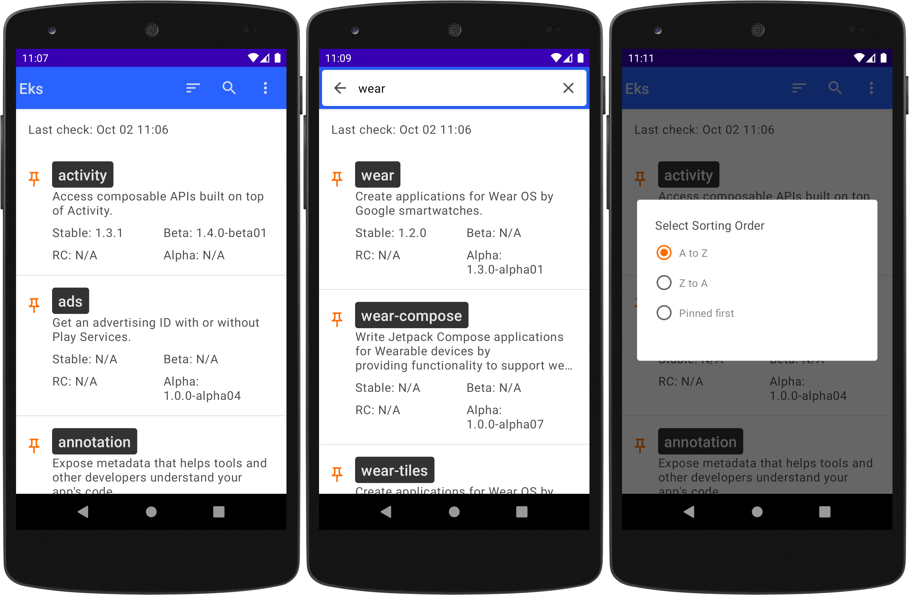
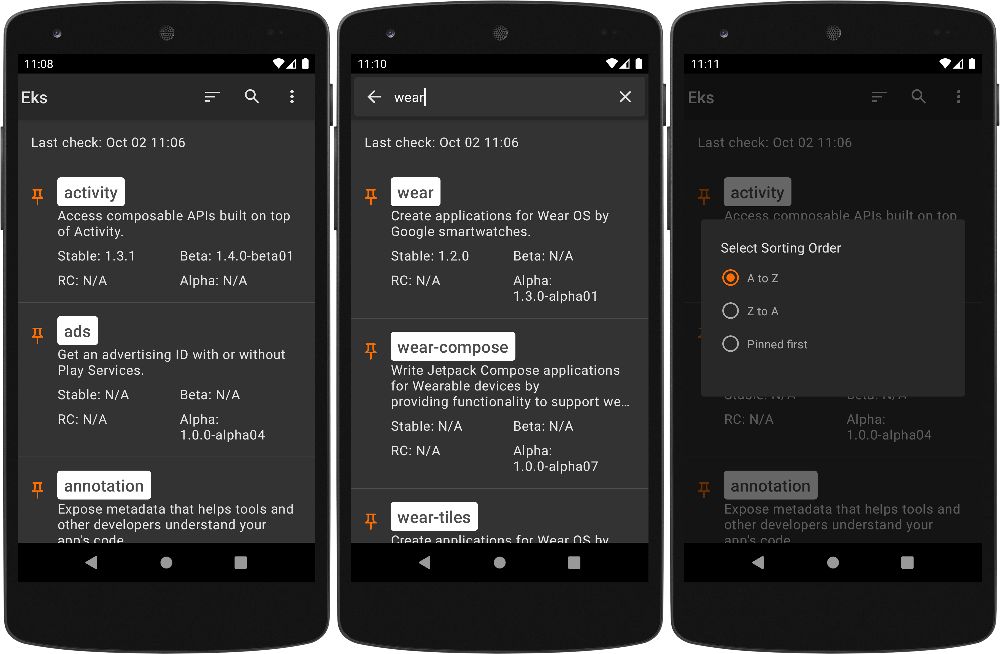

# Eks

Eks is an Android app that displays the latest version of official AndroidX libraries and
notifies you when there are updates available.

# Screenshots

# How it works

There is a [worker](https://developer.android.com/topic/libraries/architecture/workmanager) that
runs once a day. The worker parses [this](https://developer.android.com/jetpack/androidx/versions)
page to extract the latest version of the AndroidX libraries.

# Technology Stack

Eks uses the latest and greatest technologies of Android development. The following list highlights
its tech stack:

- MVI
- Compose
- ViewModel
- Coroutines
- Flow
- Room
- Dagger Hilt
- WorkManager

# Contributing

Pull requests are welcome! Please make your pull requests against the `master` branch. If you have a
feature request or bug report, please open a new issue so it could be tracked.

License
=======

    Copyright 2023 Masoud Fallahpour.

    Licensed under the Apache License, Version 2.0 (the "License");
    you may not use this file except in compliance with the License.
    You may obtain a copy of the License at

       http://www.apache.org/licenses/LICENSE-2.0

    Unless required by applicable law or agreed to in writing, software
    distributed under the License is distributed on an "AS IS" BASIS,
    WITHOUT WARRANTIES OR CONDITIONS OF ANY KIND, either express or implied.
    See the License for the specific language governing permissions and
    limitations under the License.
